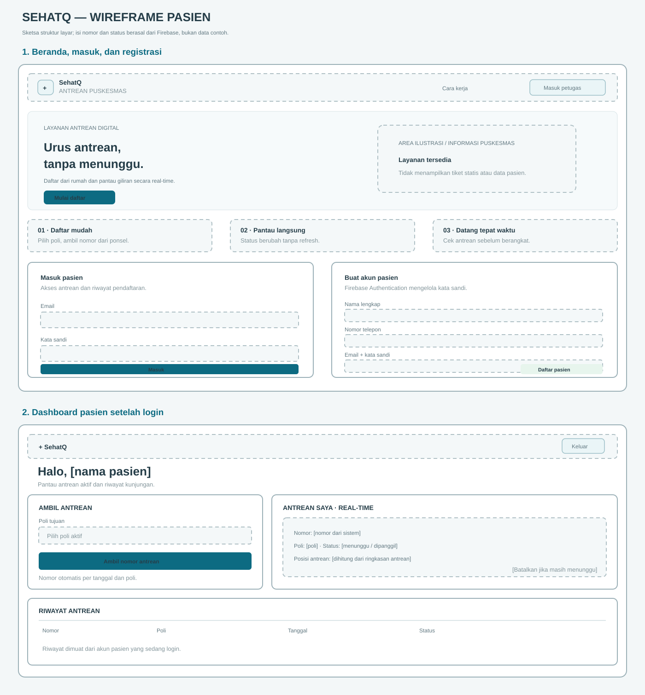
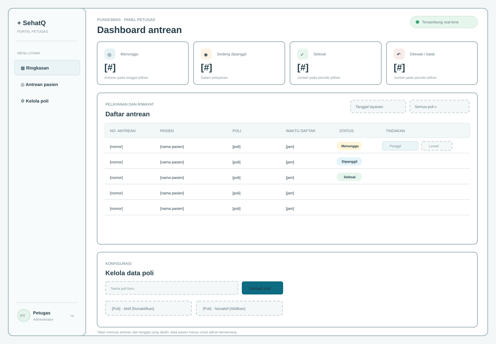
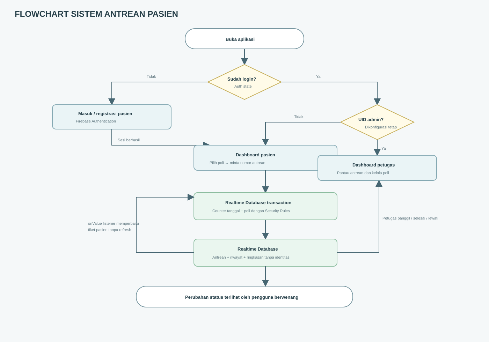

# Rancangan Wireframe dan Arsitektur

Dokumen ini menjadi rancangan layar dan alur sebelum penyesuaian tampilan berikutnya. Wireframe adalah sketsa struktur, bukan screenshot produk final.

## Keputusan metode: OOP

Proyek menggunakan **Object-Oriented Programming (OOP)** dengan JavaScript ES modules, bukan arsitektur prosedural. Pilihan ini sesuai kebutuhan awal dan memisahkan tanggung jawab autentikasi, antrean, model data, serta tampilan.

| Pendekatan | Dampak pada proyek |
|---|---|
| OOP — dipilih | Data antrean dan status dibungkus model; service mengelola Firebase; controller halaman mengelola interaksi UI. Mudah diuji dan dikembangkan per tanggung jawab. |
| Prosedural — tidak dipilih | Event handler, query Firebase, validasi, dan render berisiko bercampur di satu modul sehingga perubahan alur pasien/admin lebih sulit dirawat. |

OOP diterapkan menggunakan class, object, constructor, method, dan encapsulation melalui private fields (`#...`). `Patient` dan `Admin` mewarisi `User`; inheritance dipakai hanya untuk identitas dan perilaku yang memang berhubungan. Status antrean memiliki transisi yang dibatasi, bukan sekadar string bebas.

## Wireframe pasien — sebelum login

## Wireframe pasien — sesudah login

Bagian dashboard pasien berada di paruh bawah gambar yang sama. Nilai nomor, poli, dan status adalah placeholder wireframe; aplikasi mengambil nilai sebenarnya dari Firebase.

## Wireframe petugas — dashboard desktop

## Perilaku responsif

- **Desktop:** dashboard petugas memakai sidebar tetap; kartu statistik empat kolom; tabel antrean dapat difilter tanggal dan poli.
- **Ponsel:** sidebar menjadi header ringkas, kartu statistik dua kolom, formulir dan kartu pasien ditumpuk, tabel admin digulir horizontal.
- **Pasien:** formulir masuk/daftar menjadi satu kolom; antrean aktif dan riwayat tetap mudah dipindai.
- Semua status menggunakan teks selain warna agar tetap terbaca dan dapat diakses.

## Bagaimana sistem dibangun

1. `PatientApp` dan `AdminApp` menangani event halaman dan menggambar ulang tampilan.
2. `AuthService` membuat sesi lewat Firebase Authentication; kata sandi tidak disimpan dalam database.
3. `QueueService` membaca profil/poli, menaikkan counter dengan transaksi Realtime Database, dan memasang listener `onValue`.
4. Klien menulis antrean, indeks riwayat, dan ringkasan secara bersamaan. Database Rules membatasi bacaan/tulisan berdasarkan UID pasien atau satu UID admin tetap.
5. Untuk operasi normal melalui aplikasi, transaksi counter menghasilkan nomor yang berbeda pada pendaftaran bersamaan. Karena transaksi dijalankan klien pada paket gratis, aturan tidak dapat memberi perlindungan anti-penyalahgunaan server-side yang setara Cloud Functions.
6. Petugas mengatur nama dokter dan rata-rata menit per pasien pada data poli. Pasien melihat snapshot dokter pada riwayat serta estimasi panggilan berdasarkan antrean di depannya.
7. Firebase Hosting menyajikan halaman statis dan ES modules.

## Tahapan implementasi yang disarankan

1. Sepakati wireframe, istilah status, dan alur pasien/petugas.
2. Bangun model OOP dan uji transisi status.
3. Bangun autentikasi, profil minimal, dan aturan akses database.
4. Implementasikan pendaftaran dengan transaction Realtime Database di klien dan listener real-time; gunakan hanya data demo pada paket gratis.
5. Implementasikan dashboard petugas, riwayat, serta pengelolaan poli.
6. Verifikasi kasus black-box, rules emulator, dua sesi/perangkat, dan layout ponsel.
7. Deploy Hosting dan Rules setelah konfigurasi Firebase tersedia. Cloud Functions tidak digunakan pada konfigurasi Spark gratis.

Status kredensial, hasil tes aktual, dan fitur yang masih perlu konfigurasi dicatat di [README](../README.md) dan [laporan uji](./02-pengujian.md).
