# Arsitektur dan UML

## Arsitektur

Frontend berupa ES modules Vanilla JavaScript; modul Firebase JS SDK v11 digunakan melalui CDN. Firebase Authentication mengelola kredensial. Realtime Database menyimpan profil, poli, dokter, jadwal dokter, antrean kanonis, indeks riwayat pasien, ringkasan status tanpa PII, dan counter. Pada konfigurasi Spark gratis, `QueueService` memakai transaksi dan multi-location update dari klien; Security Rules membatasi akses pasien dan satu UID admin tetap yang disetel di konfigurasi proyek. Listener `onValue` dilepas saat sesi berubah.

Tiket menyimpan salinan nama dokter serta rata-rata durasi poli saat pasien mendaftar, agar riwayat tidak berubah saat pengaturan master diperbarui. Beranda menampilkan antrean terakhir yang dipanggil per poli; `QueueService.callNext` memakai transaksi pada antrean poli untuk memanggil urutan WAITING terawal dan memperbarui riwayat serta ringkasan. Jadwal dokter disimpan sebagai entitas terpisah dan tidak membatasi pendaftaran antrean berdasarkan jam. Estimasi panggilan pasien dihitung dari jumlah antrean aktif di depan dikalikan rata-rata menit per pasien, dan ditampilkan sebagai durasi serta perkiraan jam. Nilainya indikatif, bukan janji waktu layanan.

**Batasan demo gratis:** alokasi nomor yang menggunakan aplikasi normal diserialisasi dengan transaksi Realtime Database. Karena tidak ada backend tepercaya/rate limiting pada Spark, pengguna yang memodifikasi klien dapat menaikkan counter berulang kali atau mengganggu ringkasan. Jangan gunakan data pasien nyata atau operasi klinis produksi.

## Use case

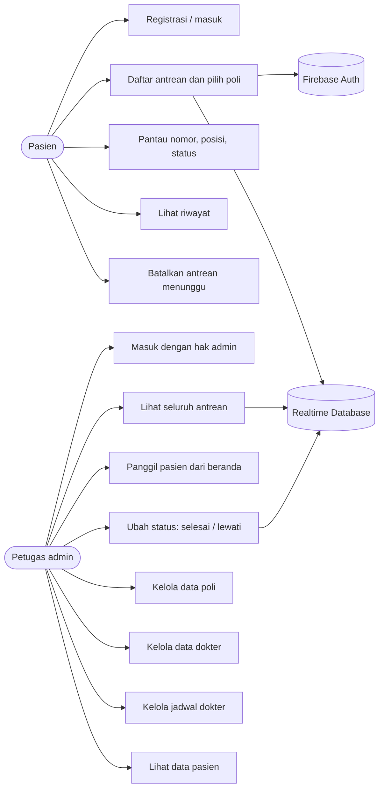

## Activity — pendaftaran antrean

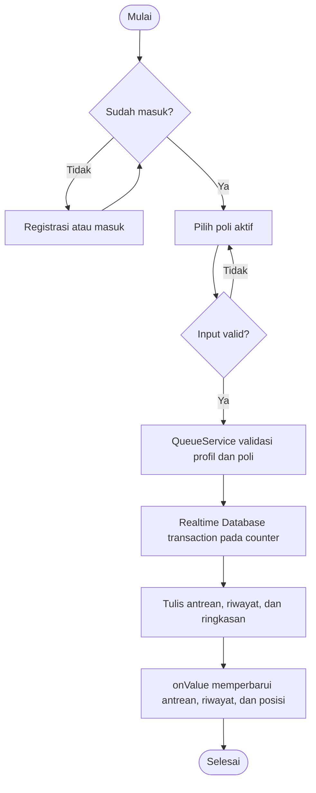

## Sequence — sinkronisasi pemanggilan

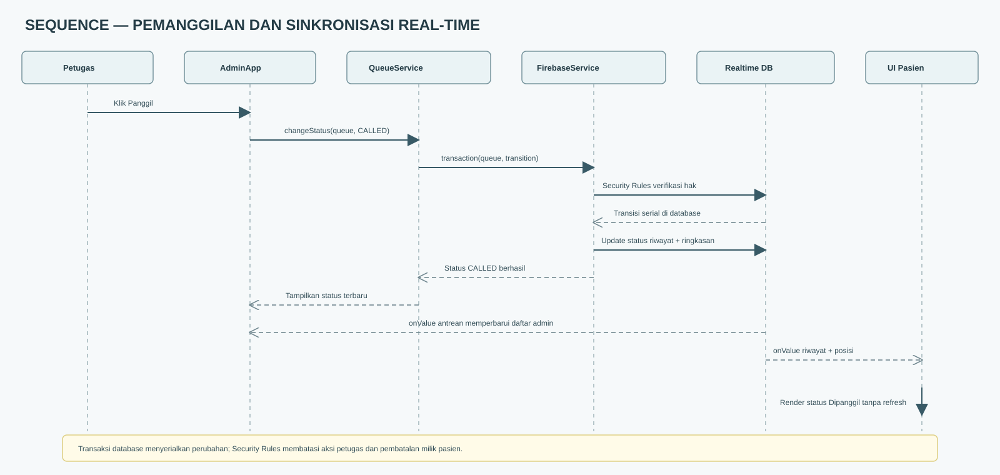

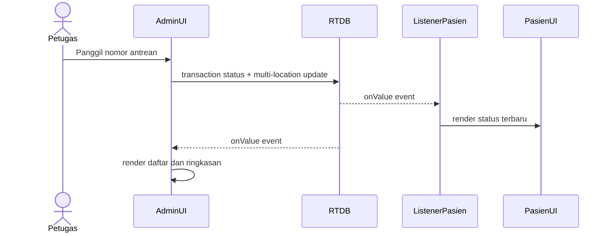

## Sequence — daftar antrean dan nomor unik

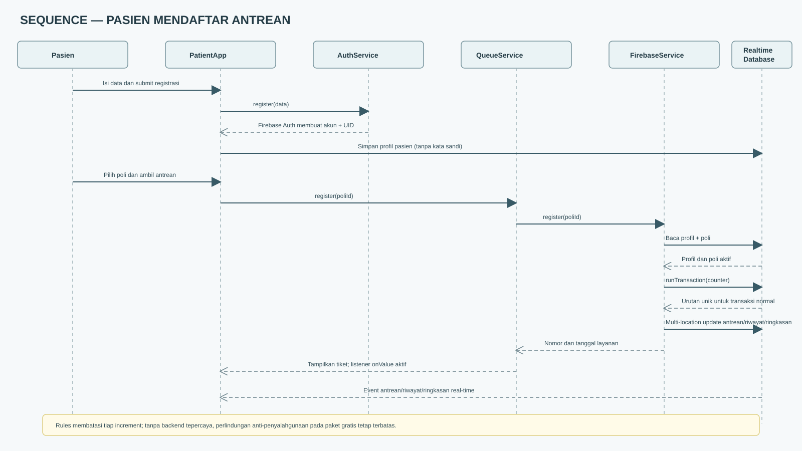

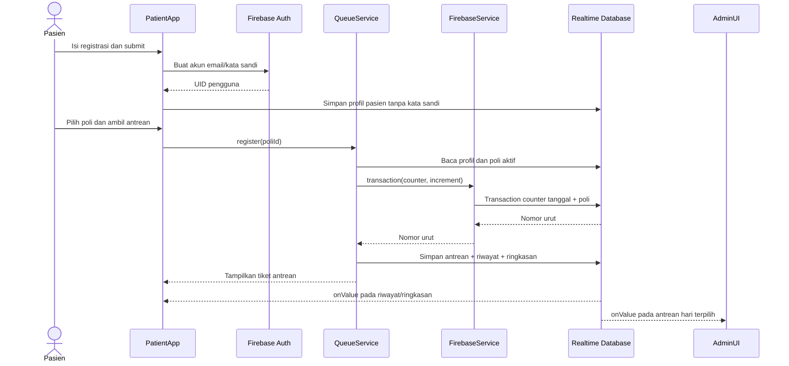

## Class diagram (sesuai implementasi)

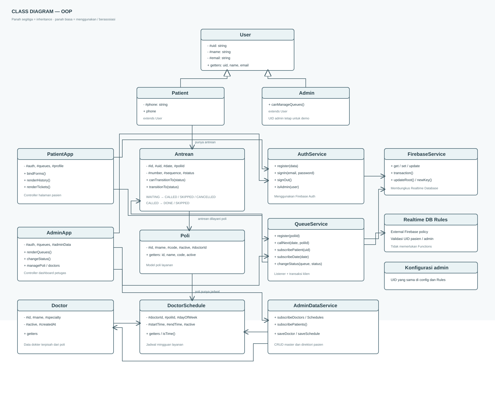

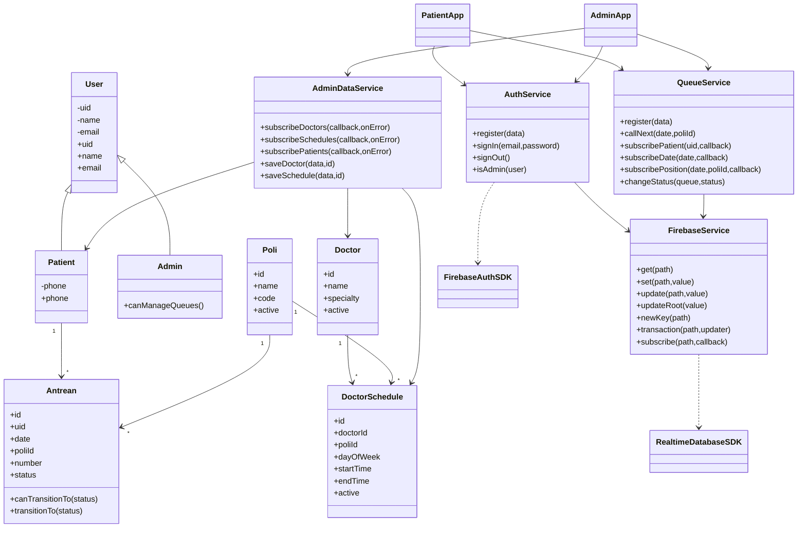

## ERD / model Realtime Database

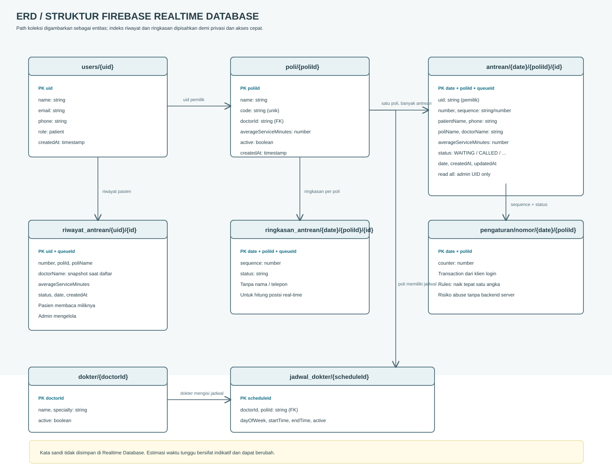

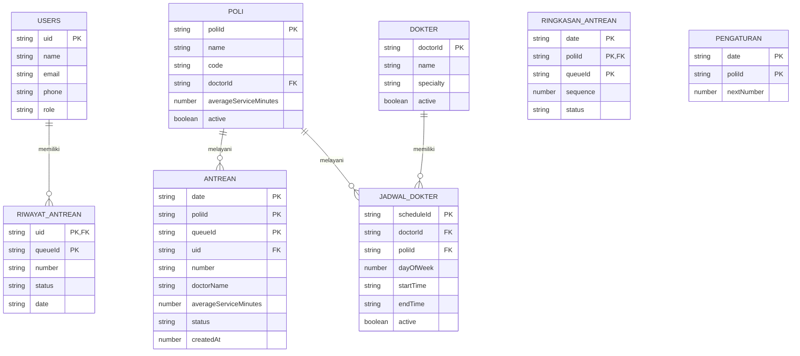

## Flowchart status antrean

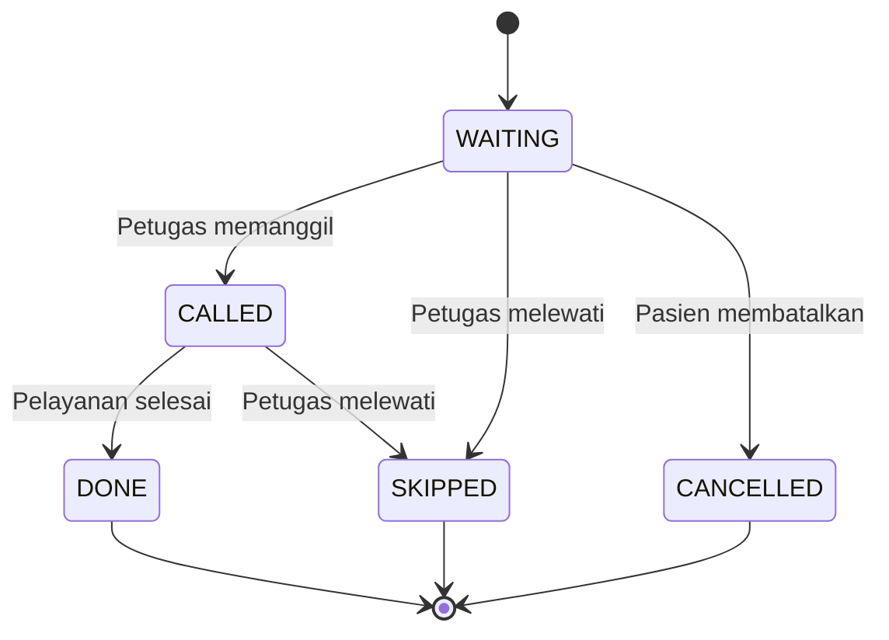

`ringkasan_antrean/{tanggal}/{poliId}/{queueId}` berisi hanya `sequence` dan `status`. Pasien terautentikasi membacanya untuk menghitung posisi tanpa akses ke identitas, kontak, atau catatan pasien lain.

## Flowchart sistem

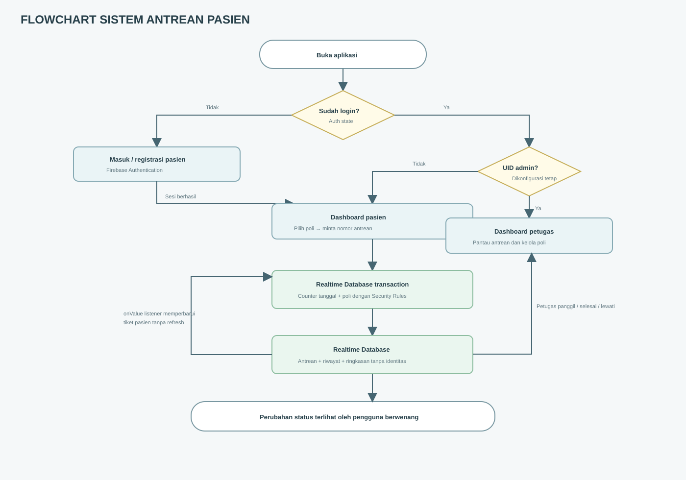

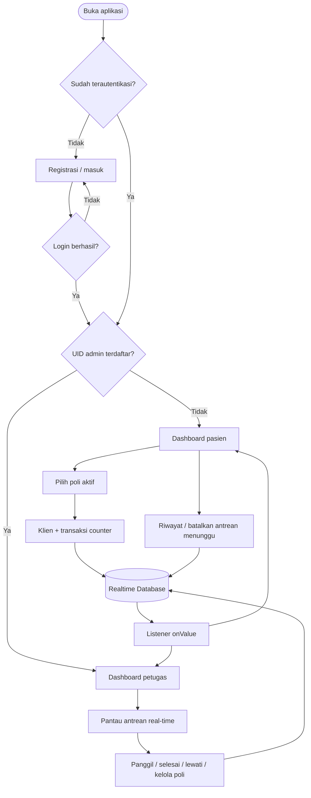
